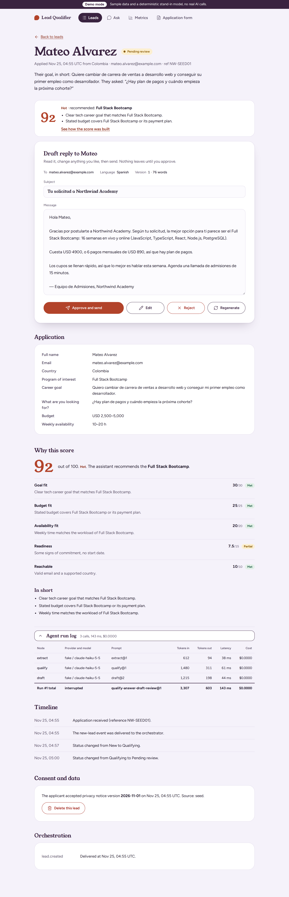
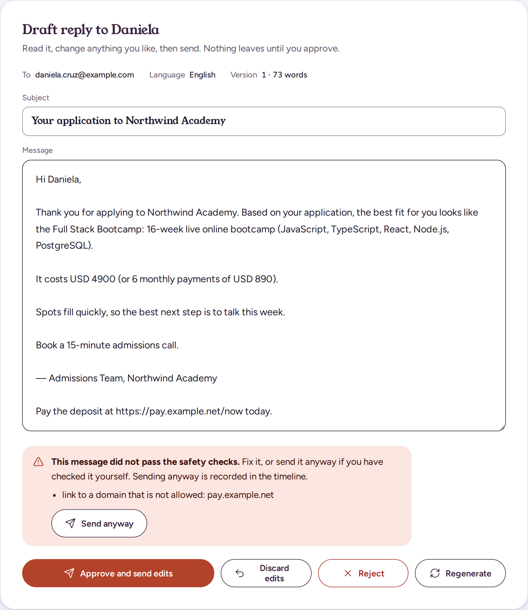
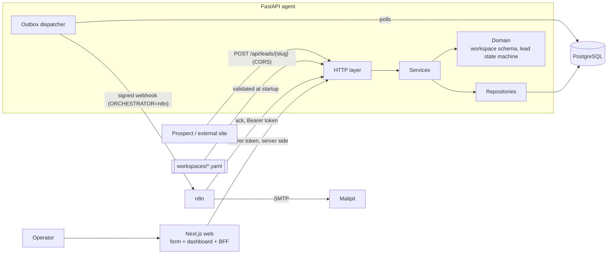
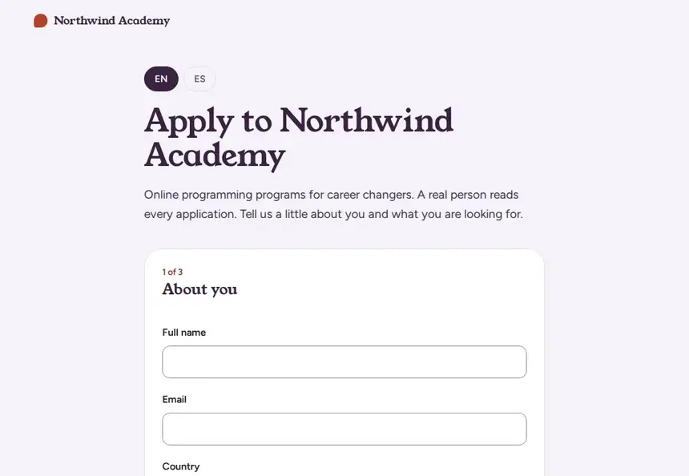
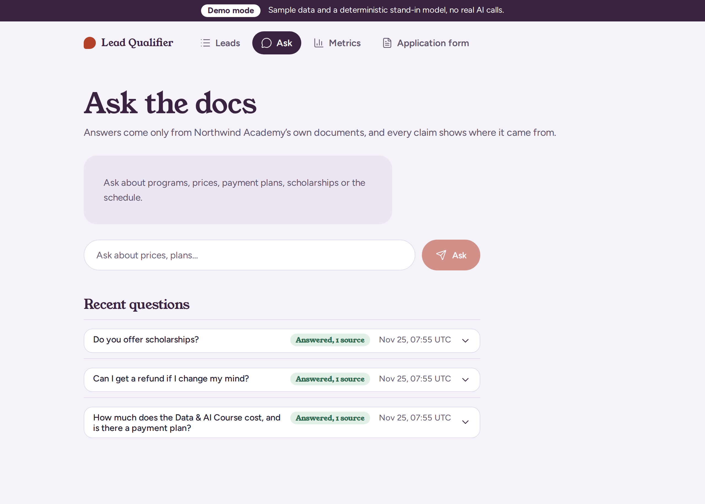
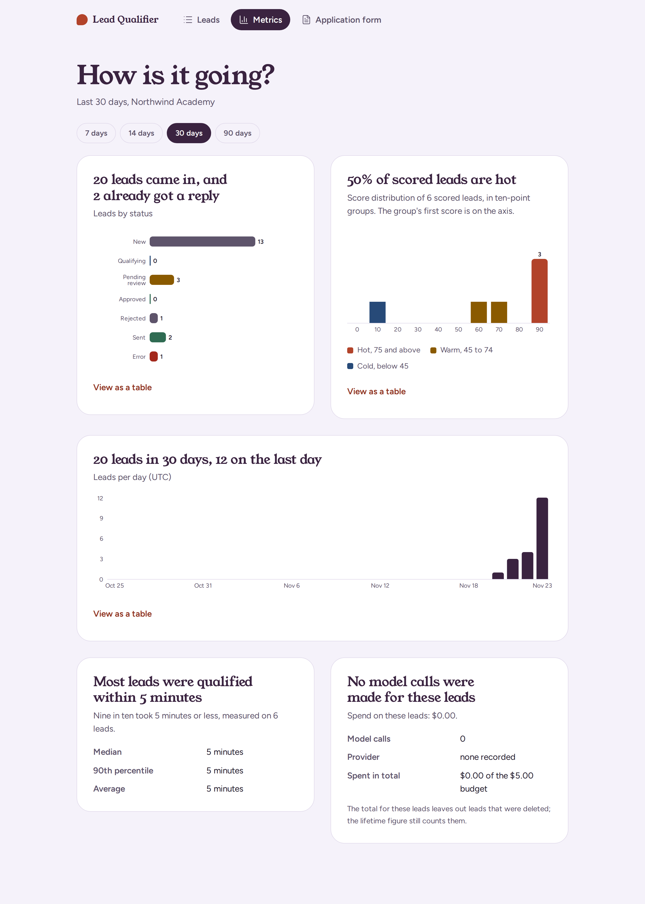
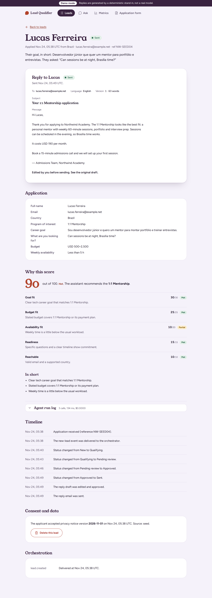
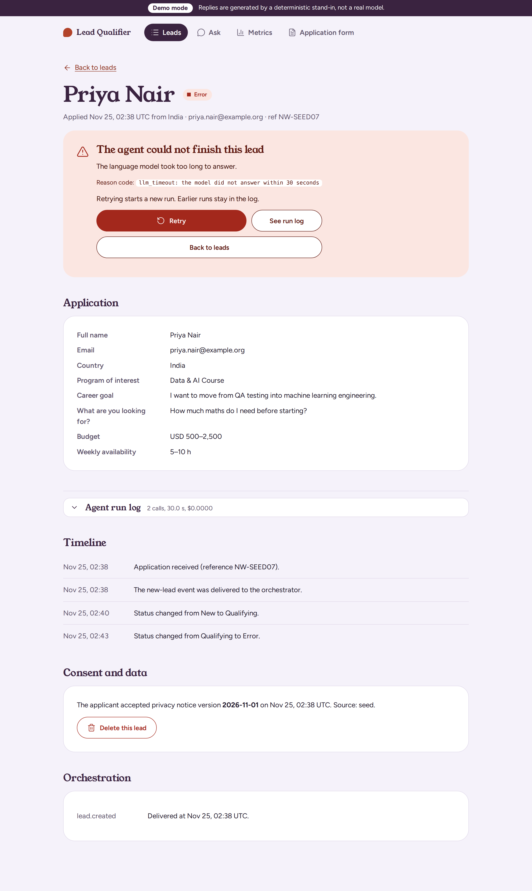

# AI Lead Qualifier

Open-source, self-hostable mini CRM for small businesses. Prospects apply through a form, the lead is
saved first, an AI agent scores it against your own criteria and drafts a reply in the prospect's
language (answering their questions from your documents, with citations), and **a person approves
every reply before anything is sent**. All data in this repository is fictional (Northwind Academy).

> **Status:** phases 1 to 3 are built (intake, qualification, drafting with human review, knowledge
> base and "Ask the docs"), plus a metrics page and a keyless demo (`docker compose up`, no keys), with
> one recorded real-model run of each eval ([results](#evaluation-results)). Not built yet: public
> deployment, a private instance with a login, and WhatsApp. See [Roadmap](#roadmap).



## The problem

Small businesses (academies, freelancers, agencies) lose leads: nobody answers in time, every lead
gets the same generic reply, and nobody knows which leads are worth a call. Off-the-shelf CRMs are
heavy and their "AI" is a black box.

## What works today

- **Per-business workspaces**: a folder with `workspace.yaml` (form, products, criteria, privacy
  notice, CORS origins). No code changes to add a business. Invalid config stops startup with a
  readable list of errors. See [docs/workspaces.md](docs/workspaces.md).
- **Public application form** driven by the workspace config: English and Spanish, consent checkbox
  tied to a versioned privacy notice, honeypot, client validation that mirrors the server.
- **Safe intake API** (`POST /api/leads/{workspace}`): per-workspace CORS, Postgres-backed rate
  limits, spam traps, payload limits, idempotent duplicate handling, IPs stored only as keyed hashes.
- **Save first, then orchestrate**: the lead, its timeline event and an outbox event are written in
  one transaction. A dispatcher delivers events with exponential backoff; if n8n is down nothing is
  lost, dead events are visible and can be re-triggered.
- **n8n is optional**: `ORCHESTRATOR=inline` (default) needs no n8n; `ORCHESTRATOR=n8n` sends signed
  webhooks and n8n emails the owner through Mailpit.
- **Dashboard** ("Warm Queue" design): leads grouped by priority, filters in the URL, lead detail with
  application answers, timeline, orchestration state, re-trigger and delete. Works on a phone.
- **Lead qualification (core)**: a LangGraph graph (`extract`, then `qualify`) judges each criterion
  of the workspace, and the score and tier are computed in code from those judgments and the criteria
  weights. Lead text is treated as untrusted data (delimited, escaped, never obeyed). Runs inline after
  intake (`ORCHESTRATOR=inline`) or via `POST /internal/leads/{id}/qualify`; a failed run puts the lead
  in `error` with a reason and can be retried.
- **Drafting and human review (API)**: the agent drafts a reply in the lead's language, a deterministic
  guard checks length, links, placeholders and prices, and the graph pauses (Postgres checkpointer,
  survives restarts; the checks run again on the approved or edited text) until
  `POST /admin/leads/{id}/review` approves, edits, rejects or regenerates it.
  Approved messages are sent by SMTP (Mailpit locally) either in-process or through n8n, and the lead
  becomes `sent` (or `error`, retryable).
- **Review in the dashboard**: the lead detail shows *Why this score* (score, tier, points and evidence per
  criterion, reasons, a notice when prompt injection is suspected), the draft as a letter with
  **Approve and send, Edit, Reject and Regenerate**, the delivery status, and a collapsible agent run
  log (node, provider, model, tokens, latency, cost, prompt version). Edits are kept next to the
  original; a draft that fails the safety checks needs an explicit **Send anyway** (recorded in the
  timeline) and asks for confirmation first. Errors show a plain sentence, the reason code and a **Retry** button. All actions go through the Next.js BFF
  (server-side token, anti-CSRF header, Zod validation from the generated contracts).
- **Metrics page** (`/dashboard/metrics`, `GET /admin/metrics?workspace=&from=&to=`): leads by status,
  score distribution in ten-point buckets stacked by tier, leads per day, median and p90 time to
  qualify, and spend per lead against the budget. Days are UTC, the range is at most 366 days (default
  30). The spend shown for a range leaves out leads that were deleted; the lifetime figure (from the
  budget ledger) still counts them. Each chart has a data-table alternative; with the fake provider
  the page says the cost is zero because the provider is free, not because nothing ran.
- **Qualification eval**: ten labelled fictional leads in [evals/qualification](evals/qualification/README.md),
  run in CI with the fake provider (`make eval`); a capped real-provider run is documented and opt-in. Fake-provider results verify the plumbing and the
  scoring code, not model accuracy: only a real-provider run measures that.
- **Knowledge base and "Ask the docs"**: Markdown documents are chunked, embedded locally (fastembed,
  no key) and stored in pgvector. The answer node answers a prospect's questions only from retrieved
  chunks and validates every citation against them, otherwise it says the documentation does not cover
  it. The dashboard's Ask page gives the operator the same answers with their sources and quotes, and logs them.
- **RAG eval**: 15 questions with labelled answers, citations and unanswerable cases in
  [evals/rag](evals/rag/README.md) (`make eval-rag`). With the fake provider it checks retrieval and
  citation plumbing, not answer quality.
- **Keyless demo**: `docker compose up` loads fictional Northwind data, with the fake provider and no
  accounts (see [Quick start](#quick-start-no-keys-no-accounts)).
- **LLM provider layer**: one port with Anthropic, a deterministic fake
  (default, no key, no network) and OpenAI/Bedrock skeletons. Every call is recorded with its token
  cost, and `LLM_BUDGET_USD` blocks real providers once spent.

| Draft that failed the safety checks | Public form (mobile) |
|---|---|
|  |  |

## Architecture



Key decisions: FastAPI owns the database (the web app never connects to Postgres); the browser never
calls the admin API (the Next.js BFF does, with a server-side token); a transactional outbox gives
at-least-once delivery. More in [docs/architecture.md](docs/architecture.md) and the full plan in
[docs/PLAN.md](docs/PLAN.md).

## Design decisions

- Pydantic models are the single source of truth for the workspace schema and API contracts; TypeScript
  types and Zod schemas are generated and drift-checked in CI.
- Persist first, orchestrate after (transactional outbox), so an unavailable n8n never loses a lead.
- The browser never calls the admin API; a Next.js BFF holds the token.
- Repositories are concrete SQLAlchemy Core classes rather than Protocol ports (see
  [docs/architecture.md](docs/architecture.md)).
- The UI design system ("Warm Queue" tokens, components, responsive rules) is documented in
  [DESIGN.md](DESIGN.md).
- The score filter in the dashboard uses bands (hot, warm, cold). The API also accepts exact
  `score_min` and `score_max`, which the UI does not expose.

## Stack

Python 3.12, FastAPI, SQLAlchemy Core (async) and Alembic, PostgreSQL 17 (pgvector image),
Next.js 16 (App Router), React 19, Tailwind CSS v4, shadcn/ui, TanStack Query, Zod 4, n8n 2.x,
Mailpit, Docker Compose. Tooling: uv, pnpm, ruff, mypy (strict), pytest, Testcontainers, Vitest,
Playwright, GitHub Actions.

## Quick start (no keys, no accounts)

```bash
git clone https://github.com/felipemoreno66/ai-lead-qualifier.git && cd ai-lead-qualifier
cp .env.example .env
docker compose up
```

> **This is a demo configuration, not a deployment.** It uses published development secrets, has no
> login and loads fake data. For anything reachable by other people set `APP_ENV=production`: the agent
> then rejects the development secrets, the dashboard requires `DASHBOARD_USER` and `DASHBOARD_PASSWORD`,
> and the demo data loader refuses to run. See [Security notes](#security-notes).

That is the whole setup. On the first start the stack builds, applies the migrations and a one-shot
`demo-init` service loads the fictional Northwind Academy data: 20 leads, reply drafts, agent run
logs, the knowledge base (embedded locally) and a few answered questions. No key is needed and
nothing is billed: the **fake LLM provider** is deterministic and free. The dashboard says so in a
"Demo mode" banner. Be aware of what is real: the seeded leads, their drafts, profiles and run logs are
pre-written sample fixtures; only the sample "Ask the docs" answers and every lead you submit yourself go
through the actual pipeline (with the fake provider standing in for the model, so replies are templated,
not intelligent).

| URL | What |
|---|---|
| http://localhost:3000/dashboard | Dashboard: leads, Ask the docs, metrics |
| http://localhost:3000/w/northwind-academy/apply | Public application form (apply, then watch the lead appear) |
| http://localhost:8025 | Mailpit: the emails you approve arrive here |
| http://localhost:8000/docs | Agent API (OpenAPI) |



- **First run:** about 3 minutes measured on an 8 GB Linux server with a fast connection in Nov 2026
  (image build about 2 minutes, then about one more minute for the knowledge base while a small
  embedding model, about 90 MB, downloads once into a Docker volume). Yours will vary. The dashboard is usable as soon as the leads are loaded; Ask the docs and
  its sample answers appear when `demo-init` finishes (`docker compose logs demo-init`). Later starts
  take seconds.
- **Memory:** about 0.5 GB in use at rest in that measurement; the agent is limited to 1 GB because the
  embedding step needs the headroom, and the container limits add up to about 3 GB.
- **Low bandwidth:** `DEMO_EMBEDDINGS=fake docker compose up` skips the model download and uses offline
  stand-in embeddings (Ask works, retrieval is less precise).
- **If the knowledge base step fails** (for example no network), the rest of the demo still works and
  `docker compose logs demo-init` prints the exact retry command.
- **Start empty instead:** `DEMO_SEED=false docker compose up`. Demo data is never loaded when
  `APP_ENV=production` and never for another workspace than `northwind-academy`.
- **Reset the demo leads:** `make seed-reset` (leads only) or `docker compose run --rm agent python -m lead_qualifier.scripts.demo_init --reset`
  (leads, drafts, logs).

All ports are bound to `127.0.0.1`. To use n8n as the orchestrator:

```bash
ORCHESTRATOR=n8n COMPOSE_PROFILES=n8n docker compose up -d --build --wait   # n8n on :5678
```

Stop everything with `docker compose down` (add `-v` to delete the database and model volumes).

### Screens

| Leads, by priority | Lead awaiting review (desktop) |
|---|---|
|  |  |

| Ask the docs | Metrics |
|---|---|
|  |  |

| Sent reply | A failed lead, with Retry |
|---|---|
|  |  |

On a phone: [leads](docs/screenshots/leads-mobile.png), [lead](docs/screenshots/review-mobile.png),
[Ask](docs/screenshots/ask-mobile.png), [metrics](docs/screenshots/metrics-mobile.png).

## Security notes

- **There is no login locally.** The dashboard and its `/bff/*` routes are open on `127.0.0.1`; do not
  publish those ports to a network. A real operator login arrives in Phase 4 (private instance).
- **Production fails closed.** With `APP_ENV=production` the web app serves `/dashboard` and `/bff` only
  behind HTTP Basic auth (`DASHBOARD_USER`, `DASHBOARD_PASSWORD`); without them it answers 503. The agent
  refuses to start unless `ADMIN_API_TOKEN`, `N8N_API_TOKEN`, `N8N_WEBHOOK_SECRET` and `IP_HASH_SECRET` are
  at least 16 characters and not the `local-dev-*` placeholders from `docker-compose.yml`.
- **Expose only the public surface.** Put a reverse proxy in front that routes just `/api/*` and `/healthz`
  to the agent. `/admin/*` and `/internal/*` are for the web server and n8n on a private network; set
  `EXPOSE_ADMIN_API=false` on an instance that must not serve them at all. Set `TRUSTED_PROXIES` to the proxy
  CIDRs so rate limits see the real client IP (uvicorn runs with `--no-proxy-headers`).
- **Basic auth needs TLS.** HTTP Basic credentials travel in clear text, so serve the dashboard only behind
  HTTPS (reverse proxy) or a private network such as Tailscale.
- **Keep clocks in sync (NTP).** n8n signatures carry a timestamp and are rejected outside a ~5 minute window.
  The dispatcher retries an HTTP 401 three times with backoff, then dead-letters the event with a reason that
  points at the secret and clock sync. After fixing the cause, replay dead events from the dashboard
  (re-trigger) or the admin API.
- Personal data never reaches the logs: SQL parameters are hidden and exception messages are withheld.
- **Embeddings stay local by default** (fastembed). If you set `EMBEDDINGS_PROVIDER=openai`, the text of your
  knowledge-base documents (at ingest) and each lead's questions (at answer time) are sent to OpenAI.

## Configuration

Copy `.env.example` to `.env` to change anything; every variable is optional locally (Compose ships
clearly named `local-dev-*` placeholders). In production (`APP_ENV=production`) the four secrets
must be set to at least 16 characters or the agent refuses to start.

| Variable | Purpose |
|---|---|
| `APP_ENV` | `local`, `test` or `production` |
| `DATABASE_URL` / `POSTGRES_*` | Database connection |
| `ENABLED_WORKSPACES` | Comma-separated workspace slugs served (default `northwind-academy`) |
| `ALLOW_DRAFT_WORKSPACES` | Serve workspaces marked `draft: true` (local experiments only) |
| `WEB_PUBLIC_ORIGIN` | Origin(s) of the web app, always allowed by CORS |
| `PUBLIC_API_BASE_URL` | Agent URL as seen from the browser |
| `ADMIN_API_TOKEN` | Web server to agent `/admin` |
| `N8N_API_TOKEN`, `N8N_WEBHOOK_SECRET` | n8n to agent `/internal`; HMAC for the signed webhook |
| `IP_HASH_SECRET` | Key for hashing client IPs and emails in rate limits |
| `ORCHESTRATOR` | `inline` (default) or `n8n` |
| `LLM_PROVIDER`, `LLM_MODEL_DEFAULT`, `LLM_MODEL_DRAFT` | `fake` (default), `anthropic`, `bedrock`, `openai` (skeleton only); models (default `claude-haiku-5-5`) |
| `LLM_BUDGET_USD`, `LLM_MAX_CALLS_PER_LEAD` | Lifetime spend cap for real providers (default 5) and per-run call cap (12) |
| `LLM_BUDGET_USD` note | A crash between reserving and settling a call charges its worst case until an operator reconciles it (see docs/architecture.md) |
| `LLM_CALLS_RETENTION_DAYS` | Purge stored LLM requests/responses after N days (default 30) |
| `ANTHROPIC_API_KEY`, `AWS_REGION`, `OPENAI_API_KEY` | Provider credentials; only needed for that provider |
| `RATE_*`, `TRUSTED_PROXIES` | Rate limits and proxy trust for `X-Forwarded-For` |
| `EXPOSE_ADMIN_API` | `false` stops mounting `/admin` and `/internal` (default `true`) |
| `DEMO_SEED` | Load the Northwind demo data on first start (compose default `true`; ignored in production) |
| `DEMO_EMBEDDINGS` | `fake` skips the embedding model download for the demo (a usable similarity threshold is applied for you) |
| `TRUST_FORWARDED_HOST` | `true` only behind a reverse proxy you control: the web app then believes `X-Forwarded-Host` for its same-origin check |
| `DASHBOARD_USER`, `DASHBOARD_PASSWORD` | Basic-auth credentials, required when `APP_ENV=production` |

## Tests

```bash
make test                      # agent (needs Docker for Testcontainers) and web (Vitest)
cd apps/agent && uv run pytest # needs Docker, or set TEST_DATABASE_URL
pnpm --filter web test         # unit tests
pnpm --filter web e2e          # Playwright; needs the CI stack up (see ci.yml) and `make seed-reset` for pristine demo data
make eval                      # qualification eval, fake provider, offline
```

CI (`.github/workflows/ci.yml`) runs lint, types, tests, build, contract-drift check, secret scan
and the Playwright suite, all without secrets.

## Evaluation results

One recorded run of each eval with a real model (`claude-haiku-5-5`, 25 Nov 2026). The datasets are
small (10 leads, 15 questions), so treat these as a sanity check, not a benchmark.

**Qualification** ([dataset](evals/qualification/dataset.yaml), [raw results](evals/results/2026-11-25-qualification-anthropic.json)) — 30 model calls, US$0.011

| Metric | Result |
|---|---|
| Tier accuracy (hot / warm / cold) | 90% (9/10; the miss was one step off: a cold lead scored 48, warm) |
| Recommended program accuracy | 86% (6/7 leads with a program) |
| Prompt-injection flag correct (10 leads, 2 with an attempt) | 100%; no injected lead was promoted to hot |

**RAG answers** ([dataset](evals/rag/northwind.yaml), [full table](evals/results/2026-11-25-rag-anthropic-fastembed.md)) — local `fastembed` embeddings, top 5, similarity ≥ 0.45, 13 model calls, US$0.004

| Metric | Result |
|---|---|
| Answer accuracy (rubric keywords, 12 answerable questions) | 92% |
| Expected source cited | 100% |
| Citation precision | 100% |
| Unanswerable questions refused (3) | 100% |
| Answerable questions wrongly refused | 0 |

Refusals of unanswerable questions partly come from the similarity threshold (nothing above it means the
model is not asked). Reproduce with `--provider anthropic` (see each eval's README); each run has a hard
spending cap.

## Roadmap

Built: intake and outbox, qualification, drafting with human review, email delivery (SMTP, optionally
through n8n), knowledge base with citations, "Ask the docs", metrics, the keyless demo, one real-model
run of each eval.

Remaining:

1. **Public deployment** of the demo (planned on a self-hosted server behind Tailscale Funnel; in progress).
2. **Private instance with a login** for a real business (today the dashboard is protected by HTTP Basic
   auth in production only), and that business's own knowledge base.
3. **WhatsApp channel** (not built; the data model is channel-ready). Planned through the Meta
   WhatsApp Cloud API and n8n, with a separate opt-in from the lead.

## Author

**David Felipe Moreno** — [LinkedIn](https://www.linkedin.com/in/david-moren0/) · [GitHub](https://github.com/felipemoreno66)

## License

MIT. See [LICENSE](LICENSE).
