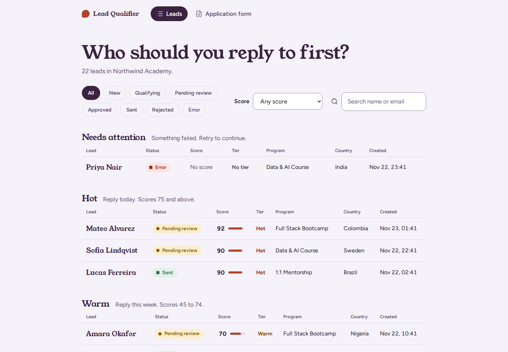
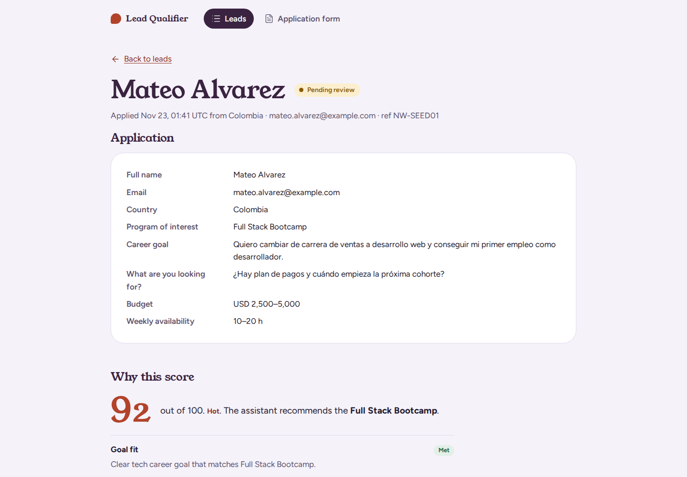
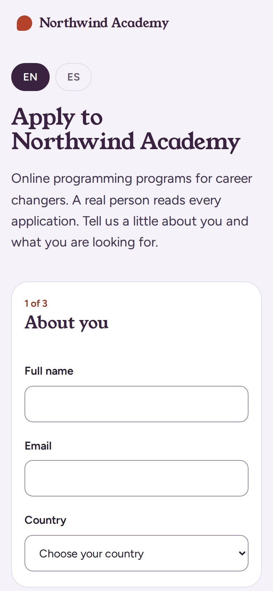
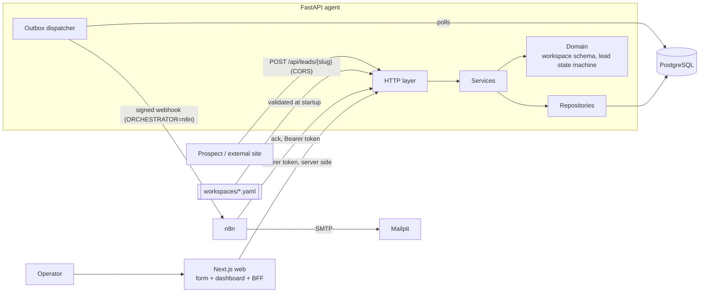

# AI Lead Qualifier

Open-source, self-hostable mini CRM for small businesses. Prospects apply through a form,
the lead is saved first and handed to an orchestrator (n8n, optional), and an operator sees every
lead ranked by priority in a dashboard. The AI qualification agent, knowledge-base answers and
approve-before-send drafting are the next phases (see [Roadmap](#roadmap)); a person will always
approve every reply.

> **Status: Phase 1 (base).** Public form, safe intake API, transactional outbox, n8n integration,
> dashboard (list, detail, timeline). All data in this repository is fictional (Northwind Academy).



## The problem

Small businesses (academies, freelancers, agencies) lose leads: nobody answers in time, every lead
gets the same generic reply, and nobody knows which leads are worth a call. Off-the-shelf CRMs are
heavy and their "AI" is a black box.

## What works today

- **Per-business workspaces**: a folder with `workspace.yaml` (form, products, criteria, privacy
  notice, CORS origins). No code changes to add a business. Invalid config stops startup with a
  readable list of errors. See [docs/workspaces.md](docs/workspaces.md).
- **Public application form** driven by the workspace config: English and Spanish, consent checkbox
  tied to a versioned privacy notice, honeypot, client validation that mirrors the server.
- **Safe intake API** (`POST /api/leads/{workspace}`): per-workspace CORS, Postgres-backed rate
  limits, spam traps, payload limits, idempotent duplicate handling, IPs stored only as keyed hashes.
- **Save first, then orchestrate**: the lead, its timeline event and an outbox event are written in
  one transaction. A dispatcher delivers events with exponential backoff; if n8n is down nothing is
  lost, dead events are visible and can be re-triggered.
- **n8n is optional**: `ORCHESTRATOR=inline` (default) needs no n8n; `ORCHESTRATOR=n8n` sends signed
  webhooks and n8n emails the owner through Mailpit.
- **Dashboard** ("Warm Queue" design): leads grouped by priority, filters in the URL, lead detail with
  application answers, timeline, orchestration state, re-trigger and delete. Works on a phone.
- **Lead qualification (core)**: a LangGraph graph (`extract`, then `qualify`) judges each criterion
  of the workspace, and the score and tier are computed in code from those judgments and the criteria
  weights. Lead text is treated as untrusted data (delimited, escaped, never obeyed). Runs inline after
  intake (`ORCHESTRATOR=inline`) or via `POST /internal/leads/{id}/qualify`; a failed run puts the lead
  in `error` with a reason and can be retried. Drafting and human review come next.
- **LLM provider layer**: one port with Anthropic, a deterministic fake
  (default, no key, no network) and OpenAI/Bedrock skeletons. Every call is recorded with its token
  cost, and `LLM_BUDGET_USD` blocks real providers once spent.

| Lead detail | Public form (mobile) |
|---|---|
|  |  |

## Architecture



Key decisions: FastAPI owns the database (the web app never connects to Postgres); the browser never
calls the admin API (the Next.js BFF does, with a server-side token); a transactional outbox gives
at-least-once delivery. More in [docs/architecture.md](docs/architecture.md) and the full plan in
[docs/PLAN.md](docs/PLAN.md).

## Design decisions

- Pydantic models are the single source of truth for the workspace schema and API contracts; TypeScript
  types and Zod schemas are generated and drift-checked in CI.
- Persist first, orchestrate after (transactional outbox), so an unavailable n8n never loses a lead.
- The browser never calls the admin API; a Next.js BFF holds the token.
- Repositories are concrete SQLAlchemy Core classes rather than Protocol ports (see
  [docs/architecture.md](docs/architecture.md)).
- The UI design system ("Warm Queue" tokens, components, responsive rules) is documented in
  [DESIGN.md](DESIGN.md).
- The score filter in the dashboard uses bands (hot, warm, cold). The API also accepts exact
  `score_min` and `score_max`, which the UI does not expose.

## Stack

Python 3.12, FastAPI, SQLAlchemy Core (async) and Alembic, PostgreSQL 17 (pgvector image),
Next.js 16 (App Router), React 19, Tailwind CSS v4, shadcn/ui, TanStack Query, Zod 4, n8n 2.x,
Mailpit, Docker Compose. Tooling: uv, pnpm, ruff, mypy (strict), pytest, Testcontainers, Vitest,
Playwright, GitHub Actions.

## Run it

Requirements: Docker with Compose v2. No API keys are needed for anything in this phase.

```bash
docker compose up -d --build --wait
docker compose run --rm agent python -m lead_qualifier.scripts.seed   # 20 fictional leads
```

| URL | What |
|---|---|
| http://localhost:3000/dashboard | Dashboard |
| http://localhost:3000/w/northwind-academy/apply | Public application form |
| http://localhost:8000/docs | Agent API (OpenAPI) |
| http://localhost:8025 | Mailpit (emails) |

All ports are bound to `127.0.0.1`. To use n8n as the orchestrator:

```bash
ORCHESTRATOR=n8n COMPOSE_PROFILES=n8n docker compose up -d --build --wait   # n8n on :5678
```

Stop everything with `docker compose down` (add `-v` to delete the database volume).

## Security notes (Phase 1)

- **There is no login locally.** The dashboard and its `/bff/*` routes are open on `127.0.0.1`; do not
  publish those ports to a network. A real operator login arrives in Phase 4 (private instance).
- **Production fails closed.** With `APP_ENV=production` the web app serves `/dashboard` and `/bff` only
  behind HTTP Basic auth (`DASHBOARD_USER`, `DASHBOARD_PASSWORD`); without them it answers 503. The agent
  refuses to start unless `ADMIN_API_TOKEN`, `N8N_API_TOKEN`, `N8N_WEBHOOK_SECRET` and `IP_HASH_SECRET` are
  at least 16 characters and not the `local-dev-*` placeholders from `docker-compose.yml`.
- **Expose only the public surface.** Put a reverse proxy in front that routes just `/api/*` and `/healthz`
  to the agent. `/admin/*` and `/internal/*` are for the web server and n8n on a private network; set
  `EXPOSE_ADMIN_API=false` on an instance that must not serve them at all. Set `TRUSTED_PROXIES` to the proxy
  CIDRs so rate limits see the real client IP (uvicorn runs with `--no-proxy-headers`).
- Personal data never reaches the logs: SQL parameters are hidden and exception messages are withheld.

## Configuration

Copy `.env.example` to `.env` to change anything; every variable is optional locally (Compose ships
clearly named `local-dev-*` placeholders). In production (`APP_ENV=production`) the four secrets
must be set to at least 16 characters or the agent refuses to start.

| Variable | Purpose |
|---|---|
| `APP_ENV` | `local`, `test` or `production` |
| `DATABASE_URL` / `POSTGRES_*` | Database connection |
| `ENABLED_WORKSPACES` | Comma-separated workspace slugs served (default `northwind-academy`) |
| `ALLOW_DRAFT_WORKSPACES` | Serve workspaces marked `draft: true` (local experiments only) |
| `WEB_PUBLIC_ORIGIN` | Origin(s) of the web app, always allowed by CORS |
| `PUBLIC_API_BASE_URL` | Agent URL as seen from the browser |
| `ADMIN_API_TOKEN` | Web server to agent `/admin` |
| `N8N_API_TOKEN`, `N8N_WEBHOOK_SECRET` | n8n to agent `/internal`; HMAC for the signed webhook |
| `IP_HASH_SECRET` | Key for hashing client IPs and emails in rate limits |
| `ORCHESTRATOR` | `inline` (default) or `n8n` |
| `LLM_PROVIDER`, `LLM_MODEL_DEFAULT`, `LLM_MODEL_DRAFT` | `fake` (default), `anthropic`, `bedrock`, `openai` (skeleton only); models (default `claude-haiku-5-5`) |
| `LLM_BUDGET_USD`, `LLM_MAX_CALLS_PER_LEAD` | Lifetime spend cap for real providers (default 5) and per-run call cap (12) |
| `LLM_BUDGET_USD` note | A crash between reserving and settling a call charges its worst case until an operator reconciles it (see docs/architecture.md) |
| `LLM_CALLS_RETENTION_DAYS` | Purge stored LLM requests/responses after N days (default 30) |
| `ANTHROPIC_API_KEY`, `AWS_REGION`, `OPENAI_API_KEY` | Provider credentials; only needed for that provider |
| `RATE_*`, `TRUSTED_PROXIES` | Rate limits and proxy trust for `X-Forwarded-For` |
| `EXPOSE_ADMIN_API` | `false` stops mounting `/admin` and `/internal` (default `true`) |
| `DASHBOARD_USER`, `DASHBOARD_PASSWORD` | Basic-auth credentials, required when `APP_ENV=production` |

## Tests

```bash
make test                      # agent (needs Docker for Testcontainers) and web (Vitest)
cd apps/agent && uv run pytest # needs Docker, or set TEST_DATABASE_URL
pnpm --filter web test         # unit tests
pnpm --filter web e2e          # Playwright; needs the stack from "Run it" plus the seed
```

CI (`.github/workflows/ci.yml`) runs lint, types, tests, build, contract-drift check, secret scan
and the Playwright suite, all without secrets.

## Roadmap

1. **Qualification agent**: LangGraph graph (extract, score against your criteria, draft in the
   lead's language) with a fake provider for keyless use, and human approve/edit/reject before any
   email is sent.
2. **Knowledge base with citations** (RAG) over your own Markdown.
3. **Metrics and keyless demo polish**, deployment notes.
4. **WhatsApp channel** (not built; the data model is channel-ready). Planned through the Meta
   WhatsApp Cloud API and n8n, with a separate opt-in from the lead.

## Author

**David Felipe Moreno** — [LinkedIn](https://www.linkedin.com/in/david-moren0/) · [GitHub](https://github.com/felipemoreno66)

## License

MIT. See [LICENSE](LICENSE).
