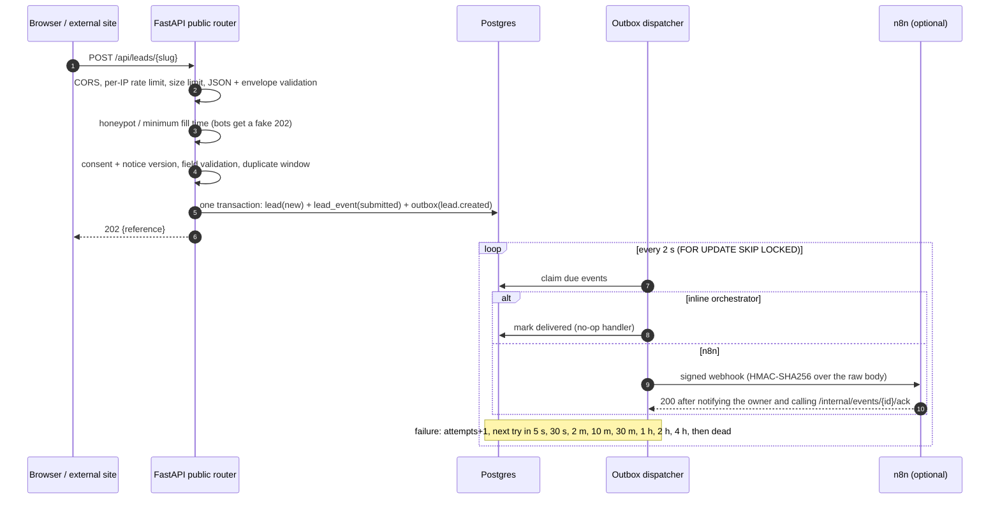
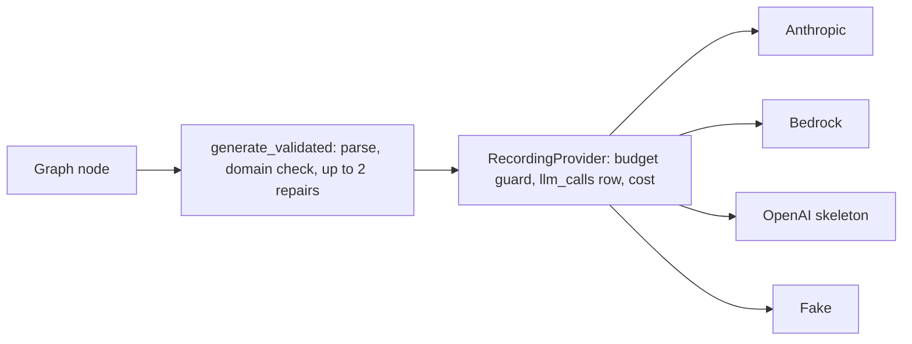

# Architecture (Phase 1)

## Layers (apps/agent)

`http` (routers, schemas, middleware) -> `services` (use cases) -> `domain` (pure models: workspace
schema, lead state machine, form validation). Services depend on small ports (`Clock`,
`EventPublisher`); adapters live in `infrastructure/` (SQLAlchemy Core repositories, outbox
dispatcher, publishers). Repositories take an `AsyncConnection`, so each use case controls its own
transaction.

**Deviation from the plan:** repositories are concrete SQLAlchemy Core classes, not Protocol ports. A port
would only be satisfied by one implementation and would hide transaction boundaries; `Clock` and
`EventPublisher`, which really have several implementations, are ports. Revisit if a second store appears.

## Lead intake

Rate-limit order matters: limits are evaluated most specific first (IP, then email, then the
workspace quota) and stop at the first one exceeded, so one abusive IP cannot use up the workspace
quota. Duplicate submissions (same workspace and email within 10 minutes) are deduplicated on the
server but answered with a freshly generated reference, so the response never reveals whether an
email already applied.

## Lead state machine

`new -> qualifying -> pending_review -> approved -> sent`, with `error` (retryable) and `rejected`.
The transition table lives in `domain/lead.py`; illegal transitions raise a 409. Phase 1 only
creates `new` leads; the other states are exercised by the seed data and become live with the agent.

## Web app

Next.js server components fetch from the agent with a server-side bearer token. Browsers talk only to
explicit `/bff/*` route handlers, which validate input with Zod, call `/admin/*`, validate the response
with Zod schemas generated from the pydantic models, and refuse state-changing requests that lack the
anti-CSRF header or come from another origin. A per-request CSP nonce is set in `proxy.ts`.

## Contracts

Pydantic is the single source of truth. `python -m lead_qualifier.scripts.export_schemas` writes JSON
Schemas and the OpenAPI document to `packages/contracts`; `pnpm contracts:generate` turns them into Zod
schemas and TypeScript types. CI regenerates and fails on drift. The dynamic form schema is built twice
(`domain/lead_form.py`, `apps/web/lib/forms/build-lead-schema.ts`) and both are tested against the same
fixtures in `packages/contracts/fixtures/lead-submissions`.

## Privacy

Only what the form collects plus consent metadata is stored. IPs are kept as HMAC-SHA256 hashes. Logs
are JSON with a redaction processor and never contain names, emails, form answers or IPs. A lead can be
hard-deleted from the dashboard (cascades to its events and outbox rows). The seed script refuses any
workspace other than the fictional demo and refuses to run in production.

## Webhook security

The agent signs `"<unix timestamp>." + raw body` with HMAC-SHA256 (`X-Timestamp`, `X-Signature`). n8n verifies
the signature in constant time and rejects timestamps older than 5 minutes, answering 401. The dispatcher treats
401/403 and other 4xx rejections as permanent: the event becomes `dead` at once with the reason, visible in the
dashboard, instead of being retried for hours.

## Exposure

Public surface: `/api/*` and `/healthz`. Private: `/admin/*` (web server, admin token) and `/internal/*`
(n8n, its own token); `EXPOSE_ADMIN_API=false` unmounts both. In production the dashboard requires HTTP Basic
auth and fails closed (503) when credentials are not configured.

## LLM provider layer

`ports/llm.py` defines `LLMProvider` (`generate_structured`, `generate_text`) and the error types.
Adapters live in `infrastructure/llm/` and stay dumb: they make one call and return typed output.

- **Anthropic** uses the official SDK with `output_config.format` (JSON schema from the pydantic model)
  and `output_config.effort`; no `temperature`/`top_p`, no prefill. The SDK retries 429/5xx/connection
  errors; 400s are never retried. Bedrock reuses it through `AsyncAnthropicBedrockMantle`
  (`anthropic.`-prefixed model ids) and is not run in CI. OpenAI is a documented skeleton.
- **Fake** is a pure function of task and input (sha256 seed). Without a handler it synthesises a valid
  instance of the requested model from its JSON schema; `script=[...]` injects invalid JSON, timeouts
  or fixed payloads for tests. Its calls cost 0 and never count against the budget.
- **Repair loop** (`structured.py`): invalid output or a failed domain check is fed back as a user
  message, at most 2 repairs, then `LLMOutputInvalid`. Each attempt is its own `llm_calls` row.
- **Cost**: `pricing.yaml` (USD per MTok, `verified_on` date) feeds `PricingTable`; unknown models
  cost 0 and are flagged `is_estimated`. `RecordingProvider` writes each call in its own transaction,
  checks the `llm_budget` view against `LLM_BUDGET_USD` before every non-fake call
  (`BudgetExceeded`) and caps calls per agent run at `LLM_MAX_CALLS_PER_LEAD` (`CallLimitExceeded`).
- **Budget**: `LLM_BUDGET_USD` is a lifetime cap kept in the append-only `llm_spend` ledger (no
  foreign keys, so purging `llm_calls` or deleting a lead never lowers it; migration 0004). The guard
  runs under a Postgres advisory lock, refuses a call when `spent + worst case of this call` passes it
  and persists a reservation that all processes see until it is settled with the real cost.
  Settling is fail-closed (runs in `finally`, retried once, falls back to the worst case); reservations
  never expire, so a crash leaves a conservative charge until an operator reconciles it; `max_tokens` is
  clamped to 8192. Unknown models are priced at the highest known rate, and `build_provider` refuses
  to start with a real provider whose model is missing from `pricing.yaml`. Every call needs an
  `agent_run_id` (`llm_calls.agent_run_id` is NOT NULL, so deleting a lead cascades to its calls).
- **PII**: stored requests/responses have emails and phone numbers redacted and are purged after
  `LLM_CALLS_RETENTION_DAYS` by the dispatcher's hourly maintenance. Provider error text is reduced to
  status code and error type. A failed insert after a paid call is logged with its cost, never lost.
- **Tables** (migration 0002, 0003): `agent_runs`, `llm_calls`, `messages` (channel-ready: `channel`,
  `channel_recipient`, nullable `subject`) and the `llm_budget` view.

Deviation from the plan: the call cap counts per agent run, not per lead across runs, because
`llm_calls` references runs; a re-run gets a fresh allowance and the global budget still applies.
