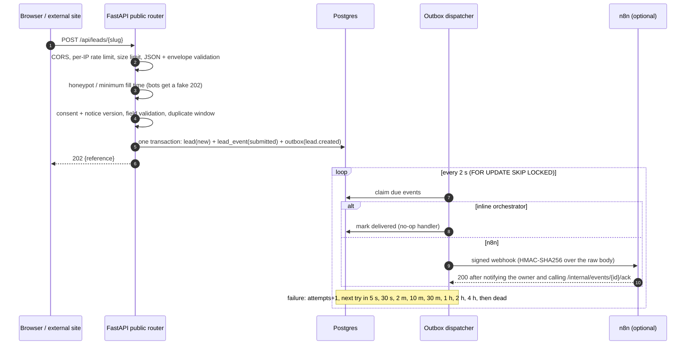

# Architecture (Phase 1)

## Layers (apps/agent)

`http` (routers, schemas, middleware) -> `services` (use cases) -> `domain` (pure models: workspace
schema, lead state machine, form validation). Services depend on small ports (`Clock`,
`EventPublisher`); adapters live in `infrastructure/` (SQLAlchemy Core repositories, outbox
dispatcher, publishers). Repositories take an `AsyncConnection`, so each use case controls its own
transaction.

## Lead intake

Rate-limit order matters: limits are evaluated most specific first (IP, then email, then the
workspace quota) and stop at the first one exceeded, so one abusive IP cannot use up the workspace
quota. Duplicate submissions (same workspace and email within 10 minutes) are deduplicated on the
server but answered with a freshly generated reference, so the response never reveals whether an
email already applied.

## Lead state machine

`new -> qualifying -> pending_review -> approved -> sent`, with `error` (retryable) and `rejected`.
The transition table lives in `domain/lead.py`; illegal transitions raise a 409. Phase 1 only
creates `new` leads; the other states are exercised by the seed data and become live with the agent.

## Web app

Next.js server components fetch from the agent with a server-side bearer token. Browsers talk only to
explicit `/bff/*` route handlers, which validate input with Zod, call `/admin/*`, validate the response
with Zod schemas generated from the pydantic models, and refuse state-changing requests that lack the
anti-CSRF header or come from another origin. A per-request CSP nonce is set in `proxy.ts`.

## Contracts

Pydantic is the single source of truth. `python -m lead_qualifier.scripts.export_schemas` writes JSON
Schemas and the OpenAPI document to `packages/contracts`; `pnpm contracts:generate` turns them into Zod
schemas and TypeScript types. CI regenerates and fails on drift. The dynamic form schema is built twice
(`domain/lead_form.py`, `apps/web/lib/forms/build-lead-schema.ts`) and both are tested against the same
fixtures in `packages/contracts/fixtures/lead-submissions`.

## Privacy

Only what the form collects plus consent metadata is stored. IPs are kept as HMAC-SHA256 hashes. Logs
are JSON with a redaction processor and never contain names, emails, form answers or IPs. A lead can be
hard-deleted from the dashboard (cascades to its events and outbox rows). The seed script refuses any
workspace other than the fictional demo and refuses to run in production.
