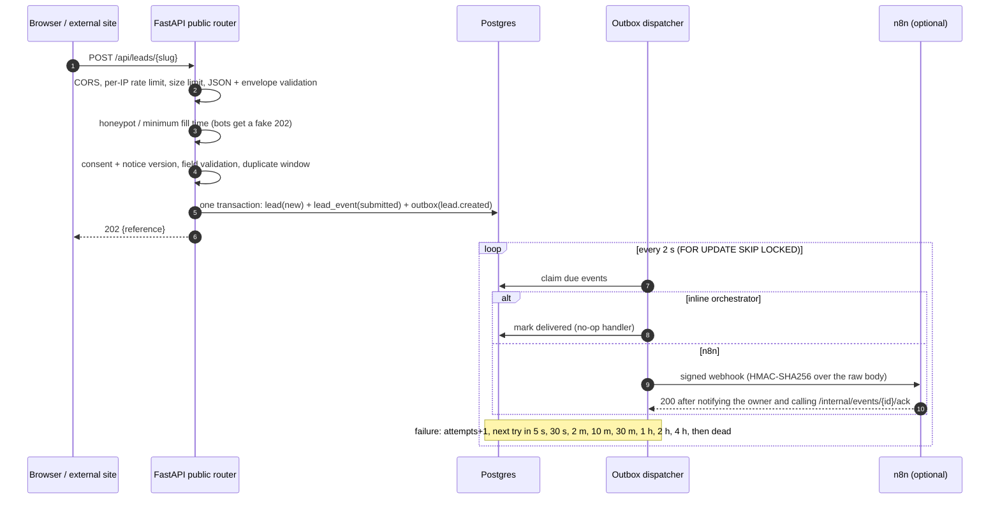
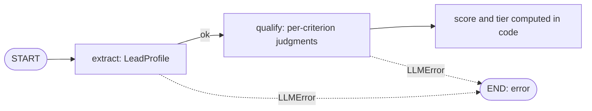
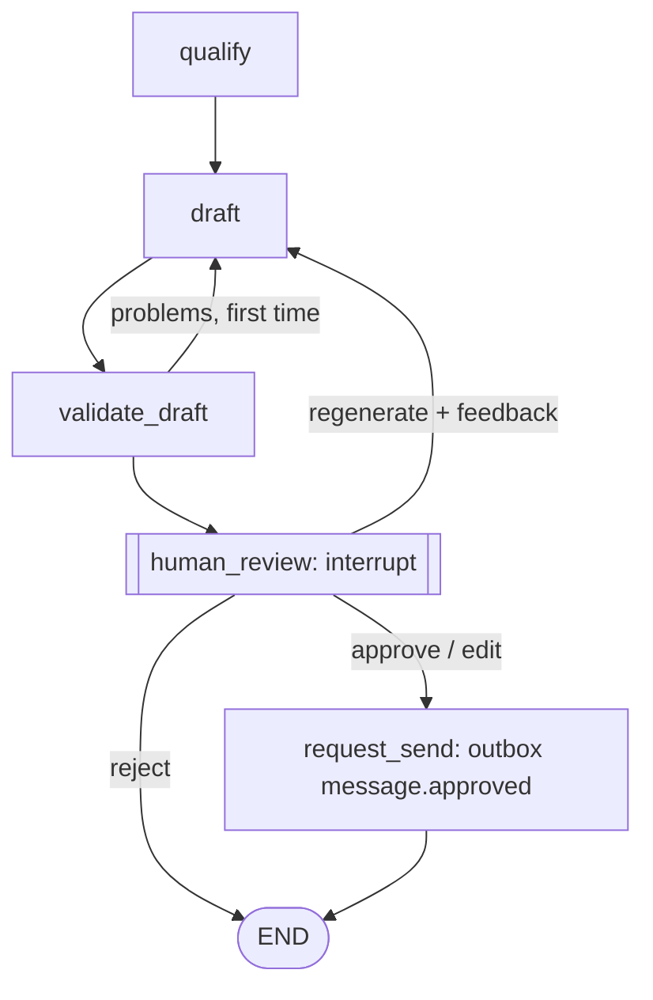
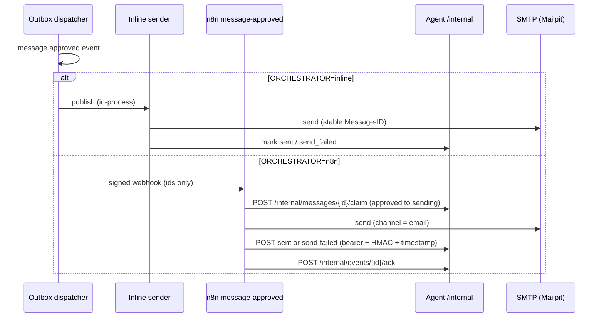
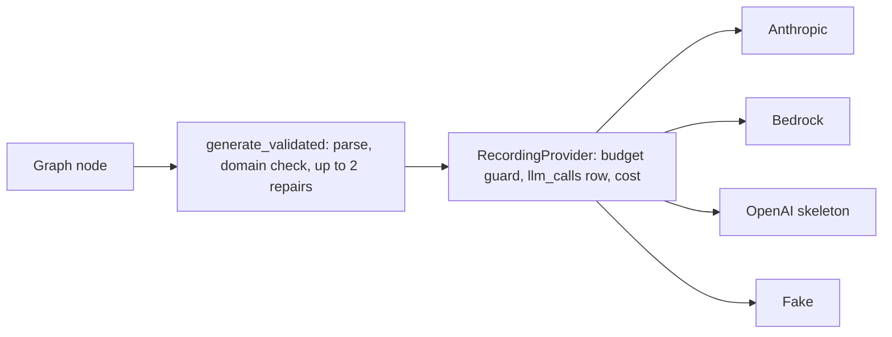

# Architecture (Phase 1)

## Layers (apps/agent)

`http` (routers, schemas, middleware) -> `services` (use cases) -> `domain` (pure models: workspace
schema, lead state machine, form validation). Services depend on small ports (`Clock`,
`EventPublisher`); adapters live in `infrastructure/` (SQLAlchemy Core repositories, outbox
dispatcher, publishers). Repositories take an `AsyncConnection`, so each use case controls its own
transaction.

**Deviation from the plan:** repositories are concrete SQLAlchemy Core classes, not Protocol ports. A port
would only be satisfied by one implementation and would hide transaction boundaries; `Clock` and
`EventPublisher`, which really have several implementations, are ports. Revisit if a second store appears.

## Lead intake

Rate-limit order matters: limits are evaluated most specific first (IP, then email, then the
workspace quota) and stop at the first one exceeded, so one abusive IP cannot use up the workspace
quota. Duplicate submissions (same workspace and email within 10 minutes) are deduplicated on the
server but answered with a freshly generated reference, so the response never reveals whether an
email already applied.

## Lead state machine

`new -> qualifying -> pending_review -> approved -> sent`, with `error` (retryable) and `rejected`.
The transition table lives in `domain/lead.py`; illegal transitions raise a 409. Phase 1 only
creates `new` leads; the other states are exercised by the seed data and become live with the agent.

## Web app

Next.js server components fetch from the agent with a server-side bearer token. Browsers talk only to
explicit `/bff/*` route handlers, which validate input with Zod, call `/admin/*`, validate the response
with Zod schemas generated from the pydantic models, and refuse state-changing requests that lack the
anti-CSRF header or come from another origin. A per-request CSP nonce is set in `proxy.ts`.

## Contracts

Pydantic is the single source of truth. `python -m lead_qualifier.scripts.export_schemas` writes JSON
Schemas and the OpenAPI document to `packages/contracts`; `pnpm contracts:generate` turns them into Zod
schemas and TypeScript types. CI regenerates and fails on drift. The dynamic form schema is built twice
(`domain/lead_form.py`, `apps/web/lib/forms/build-lead-schema.ts`) and both are tested against the same
fixtures in `packages/contracts/fixtures/lead-submissions`.

## Privacy

Only what the form collects plus consent metadata is stored. IPs are kept as HMAC-SHA256 hashes. Logs
are JSON with a redaction processor and never contain names, emails, form answers or IPs. A lead can be
hard-deleted from the dashboard (cascades to its events and outbox rows). The seed script refuses any
workspace other than the fictional demo and refuses to run in production.

## Webhook security

The agent signs `"<unix timestamp>." + raw body` with HMAC-SHA256 (`X-Timestamp`, `X-Signature`). n8n verifies
the signature in constant time and rejects timestamps older than 5 minutes, answering 401. The dispatcher treats
401/403 and other 4xx rejections as permanent: the event becomes `dead` at once with the reason, visible in the
dashboard, instead of being retried for hours.

## Exposure

Public surface: `/api/*` and `/healthz`. Private: `/admin/*` (web server, admin token) and `/internal/*`
(n8n, its own token); `EXPOSE_ADMIN_API=false` unmounts both. In production the dashboard requires HTTP Basic
auth and fails closed (503) when credentials are not configured.

## Qualification graph (M2.2)

- `agent/graph.py` (LangGraph `StateGraph` with a typed state and a `GraphDeps` run context),
  `agent/prompts.py` (versions `extract@1`, `qualify@1`, stored in `agent_runs.prompt_versions`),
  `domain/scoring.py` (judgment met/partial/unmet = 1/0.5/0, weights normalised, tiers from the
  workspace config).
- Prompt-injection defences: lead data is JSON inside `<lead_submission>` with `<`/`>` escaped; the
  system prompt says it is data; no tools; `qualify` output must name every criterion exactly once and a
  real product id (otherwise the repair loop, then `llm_output_invalid`); the model never emits the score.
  The extract step flags injection attempts and the fake provider then ignores the free text.
- `QualifyService` creates the `agent_runs` row (`thread_id = lead:<id>:run:<n>`), runs the graph, stores
  score, tier, product, language and `qualification` on the lead, and sums the run's cost. A failed run
  moves the lead to `error` with `error_reason` (`llm_timeout`, `budget_exceeded`, ...); retrying starts
  a new run. In `inline` mode the outbox dispatcher calls the service for `lead.created`.
- The fake provider's rule-based extract/qualify handlers (`infrastructure/llm/fake_handlers.py`) read
  the same rendered prompt, so the keyless demo produces explainable judgments.

### Drafting and human review (M2.3)

- `draft` writes in the lead's language (falls back to the workspace default when unsupported) using
  the workspace tone, signature and call to action, and only the recommended product's facts. Its
  output has `subject`, `body` and an optional plain-text `short_body` for a future WhatsApp channel.
  `LLM_MODEL_DRAFT` selects a different model for this node.
- `validate_draft` (`domain/draft_guard.py`, no LLM): word limit, links only on
  `allowed_link_domains`, only the business's email addresses, no placeholders, every amount must be a
  price fact from the config (product amounts and numbers in price notes), a language sanity check and
  `short_body` rules. Every content rule covers subject, body and `short_body` together, links are
  parsed like a browser would (userinfo, `\`, `%`, odd ports and non-hostname characters are rejected,
  hosts are compared in punycode so look-alikes fail, bare domains such as `evil.com/x` count as links)
  and an operator edit clears `short_body`. A failing draft is regenerated once with the problems as feedback; if it still
  fails it goes to review with the problems shown as `guard_warnings`.
- The graph runs with the Postgres checkpointer (schema `langgraph`, created on first use) and one
  thread per run. `human_review` contains only `interrupt()`; the paused thread survives an agent
  restart. The draft is stored in `messages` (status `draft`, `channel='email'`) and the lead becomes
  `pending_review`.
- `POST /admin/leads/{id}/review` with `approve`, `edit` (needs `body`), `reject` or `regenerate`
  (optional `feedback`): 409 unless the lead is in `pending_review` with a draft, 422 on a bad payload.
  Approve and edit resume the graph; `request_send` is one transaction that approves the message
  (an edit keeps `original_body`), inserts the `message.approved` outbox event under the unique key
  `message:<id>:send` and moves the lead to `approved`. A replay is a no-op. Regenerate marks the old
  draft `rejected` with the feedback and creates version n+1.
- The draft checks (`check_draft_detailed`) run again on the **final** text when the operator approves
  or edits: problems answer 422 with their codes unless the request carries `override: true`, which is
  recorded in the timeline (`reviewed` event with the problem codes). Control and bidirectional
  characters are rejected in subjects and bodies. Only fixed problem codes (never lead-derived text)
  are fed back to the model when it redrafts.
- Each review action is claimed first: one transaction holds a row lock on the lead and writes the
  new state (an approval also queues `message.approved` once); only then is the paused graph resumed.
  A concurrent second request sees the new status (409), except that approving an already approved
  lead answers 200 with the same result. If resuming fails after the claim, the database stays the
  source of truth and the paused thread is discarded.
- Checkpoints contain lead data: deleting a lead deletes its threads (retried), and the dispatcher's
  hourly maintenance also removes orphaned threads and threads of runs that finished more than
  `LLM_CALLS_RETENTION_DAYS` ago. Runs waiting for a human are never purged.
- `agent_runs.duration_ms` includes the time spent waiting for review, and regenerating reuses the
  same run (so the call cap and cost cover every draft).
- Approved messages are queued as `message.approved` and sent as described below.

### Sending (M2.4)

- `ports/channel.py` defines `MessageChannel` (`validate_recipient`, `render`) and `EmailSender`;
  `domain/channel.py` has the only implementation, `EmailChannel`. A message whose channel has no
  implementation (for example `whatsapp`) fails cleanly with `send_failed`.
- `services/delivery.py` is idempotent: a message that is no longer `approved` is not sent again, so an
  outbox event delivered twice sends one email. The email carries a `Message-ID` derived from the
  stored message, so even a crash between sending and recording can be recognised downstream.
- Success: message `sent`, lead `sent` with `sent_at`, timeline event `email_sent`. Failure: message
  `failed`, lead `error` with reason `send_failed: the message could not be delivered`; only the error
  type is kept because SMTP errors can contain the recipient's address. Retrying the lead
  re-qualifies it and drafts a new message.
- The webhook to n8n carries ids only; n8n claims the content on the private authenticated API.
- **Delivery is at-least-once with a stable `Message-ID`, but guarded by a claim.** Before any SMTP
  call the message moves from `approved` to `sending` under `FOR UPDATE` (inline `deliver` and n8n's
  `/claim`), so a redelivered event or a second worker sees `sending`/`sent` and does nothing. A claim
  that is never settled (a crash between the SMTP call and its report) is **not** resent: the
  dispatcher logs `stale_sending_messages` after `SEND_STALE_MINUTES`, and an operator checks the
  mailbox, then settles the row with `POST /internal/messages/{id}/sent` or `/send-failed`.
- Transient SMTP failures (4xx, timeouts, connection errors) release the claim and leave the outbox
  event undelivered so it is retried with backoff, up to `SEND_MAX_ATTEMPTS` (default 3); permanent
  ones (5xx) fail the message at once. In n8n mode the Send email node retries three times itself.
- A `sent` report that arrives after the message was marked `failed` wins: the message and, if it is
  still in `error: send_failed`, the lead move to `sent` and the timeline records `late_report`.
- n8n's Send email node cannot set custom headers, so in n8n mode the `Message-ID` is the one the
  node generates (reported back as `provider_message_id`); the claim, not the header, prevents a
  second send. SMTP credentials are refused without STARTTLS or SSL (startup fails).

## LLM provider layer

`ports/llm.py` defines `LLMProvider` (`generate_structured`, `generate_text`) and the error types.
Adapters live in `infrastructure/llm/` and stay dumb: they make one call and return typed output.

- **Anthropic** uses the official SDK with `output_config.format` (JSON schema from the pydantic model)
  and `output_config.effort`; no `temperature`/`top_p`, no prefill. The SDK retries 429/5xx/connection
  errors; 400s are never retried. Bedrock reuses it through `AsyncAnthropicBedrockMantle`
  (`anthropic.`-prefixed model ids) and is not run in CI. OpenAI is a documented skeleton.
- **Fake** is a pure function of task and input (sha256 seed). Without a handler it synthesises a valid
  instance of the requested model from its JSON schema; `script=[...]` injects invalid JSON, timeouts
  or fixed payloads for tests. Its calls cost 0 and never count against the budget.
- **Repair loop** (`structured.py`): invalid output or a failed domain check is fed back as a user
  message, at most 2 repairs, then `LLMOutputInvalid`. Each attempt is its own `llm_calls` row.
- **Cost**: `pricing.yaml` (USD per MTok, `verified_on` date) feeds `PricingTable`; unknown models
  cost 0 and are flagged `is_estimated`. `RecordingProvider` writes each call in its own transaction,
  checks the `llm_budget` view against `LLM_BUDGET_USD` before every non-fake call
  (`BudgetExceeded`) and caps calls per agent run at `LLM_MAX_CALLS_PER_LEAD` (`CallLimitExceeded`).
- **Budget**: `LLM_BUDGET_USD` is a lifetime cap kept in the append-only `llm_spend` ledger (no
  foreign keys, so purging `llm_calls` or deleting a lead never lowers it; migration 0004). The guard
  runs under a Postgres advisory lock, refuses a call when `spent + worst case of this call` passes it
  and persists a reservation that all processes see until it is settled with the real cost.
  Settling is fail-closed (runs in `finally`, retried once, falls back to the worst case); reservations
  never expire, so a crash leaves a conservative charge until an operator reconciles it; `max_tokens` is
  clamped to 8192. Unknown models are priced at the highest known rate, and `build_provider` refuses
  to start with a real provider whose model is missing from `pricing.yaml`. Every call needs an
  `agent_run_id` (`llm_calls.agent_run_id` is NOT NULL, so deleting a lead cascades to its calls).
- **Reconciling the ledger**: reservations never expire, so a process that crashes between reserving
  and settling leaves a worst-case charge. Check the provider's usage page, then settle the stuck rows
  with their real cost: `UPDATE llm_spend SET state='settled', amount_usd=<usd>, settled_at=now()
  WHERE state='reserved' AND created_at < now() - interval '1 hour' AND id = '<id>';`. `DELETE` and
  `TRUNCATE` on `llm_spend` are blocked by triggers (migration 0006); a test database can bypass them
  with `SET LOCAL app.allow_spend_reset = 'on'`. Timeouts and broken connections also keep the worst
  case, because the provider may have billed a request whose response never arrived. The worst case
  counts one token per UTF-8 byte of the prompt and schema plus 25%, so non-ASCII text is covered.
- **PII**: stored requests/responses have emails and phone numbers redacted (only ASCII addresses and numbers of 9+ digits; names and free text are not masked, so retention is the real control) and are purged after
  `LLM_CALLS_RETENTION_DAYS` by the dispatcher's hourly maintenance. Provider error text is reduced to
  status code and error type. A failed insert after a paid call is logged with its cost, never lost.
- **Tables** (migration 0002, 0003): `agent_runs`, `llm_calls`, `messages` (channel-ready: `channel`,
  `channel_recipient`, nullable `subject`) and the `llm_budget` view.

Deviation from the plan: the call cap counts per agent run, not per lead across runs, because
`llm_calls` references runs; a re-run gets a fresh allowance and the global budget still applies.

## Knowledge base ingestion (M3.2)

`python -m lead_qualifier.scripts.ingest_kb <workspace> [--force]` (or `POST /admin/kb/{slug}/reindex`,
admin token) reads `workspaces/<slug>/<knowledge_base.path>/*.md` and stores chunks in pgvector.

- **Chunking** (`domain/kb_chunker.py`): LangChain `MarkdownHeaderTextSplitter` on `#` to `####`, then a
  recursive splitter caps each section. The cap is a property of the embedding model
  (`Embeddings.max_chunk_tokens`): fastembed's MiniLM reads only 128 word pieces and drops the rest, so its
  chunks are at most 120 estimated tokens with 20 overlap, counting the document title and heading path that
  are embedded with the text. The token estimate is deliberately pessimistic (no tokenizer download).
  OpenAI uses 500/50. Each chunk keeps its heading path (`Pricing > Bootcamp > Payment plan`).
- **Idempotent**: the stored hash covers the file bytes, the chunker version and the model's chunk size, so
  editing a file or changing the chunking re-ingests it, and nothing else. Documents deleted from disk lose
  their chunks. A file that is skipped (symlink or outside the folder, over 1 MB, invalid UTF-8) keeps its
  last good version in the database and is reported as `skipped`.
- **Concurrency**: chunking and embedding run before the transaction; only the writes run under a per-workspace
  advisory lock. A second reindex of the same workspace in the same process gets `409`, and a reindex that
  exceeds `KB_REINDEX_TIMEOUT_SECONDS` answers `504`.
- **Embeddings port** (`ports/embeddings.py`): `fastembed` with
  `paraphrase-multilingual-MiniLM-L12-v2` (384 dimensions), an optional OpenAI adapter
  (`text-embedding-3-small` at 384 dimensions, redirects off, untested against the real API) and a
  deterministic `FakeEmbeddings` used by tests and CI.
- **Model download**: not at image build. Run `python -m lead_qualifier.scripts.ingest_kb --warm` once (or set
  `EMBEDDINGS_WARM_ON_STARTUP=true`) so the first reindex does not wait for the download. The model files live
  in `EMBEDDINGS_CACHE_DIR`; fastembed has no revision pin, so the exact files are whatever the cache volume
  holds. Keep the volume to freeze them, and re-ingest if you ever replace it.
- **Similarity threshold**: `KB_MIN_SIMILARITY` is optional; empty means the embedding model's own default
  (`Embeddings.default_min_similarity`: 0.45 for fastembed MiniLM, 0.3 for the fake). Similarity scales differ
  by model. On the Northwind eval with fastembed (fake LLM): 0.3 answered every unanswerable question, 0.4 to
  0.6 refused all of them with no false refusals, and 0.65 refused 3 answerable ones. Re-run the sweep when the
  model or the documents change.
- **Container**: the agent runs as an unprivileged user, so the model and the Hugging Face client cache both
  live in the `fastembed_cache` volume (`EMBEDDINGS_CACHE_DIR=/var/cache/fastembed`, `HF_HOME` under it).
  With the model loaded the agent peaks at about 730 MiB, so its limit is 1 GB and the whole stack needs
  roughly 1.1 GB of RAM.
- **Tables** (migration `0010`): `kb_documents`, `kb_chunks` with `vector(384)`, an HNSW index with
  `vector_cosine_ops` and a CHECK on `embedding_model`. Retrieval (`KnowledgeBaseService.retrieve`) only
  compares vectors of the active model and returns the top-k above a minimum cosine similarity.
- `knowledge_base.path` must be a relative folder without `..`.

