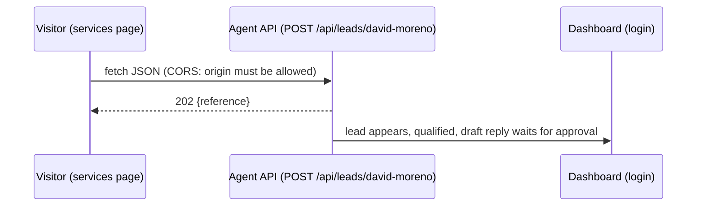

# Connect your services page to the private instance

How the contact form of an existing website (plain HTML, no framework) sends leads to the
`david-moreno` workspace of a private instance. The browser calls the agent's public endpoint
directly; no server code is needed on the website.



Replace the placeholders before going live:

| Placeholder | Meaning |
|---|---|
| `https://API.EXAMPLE.COM` | public URL of the agent of the private instance (`PUBLIC_API_BASE_URL`) |
| `https://SERVICES-PAGE.EXAMPLE.COM` | exact origin of the page that hosts the form (**TODO(david): real domain**) |

## 1. Allow the website's origin (CORS)

Browsers only let the page call the API when its origin is listed. Edit
`workspaces/david-moreno/workspace.yaml`:

```yaml
cors:
  allowed_origins:
    - https://SERVICES-PAGE.EXAMPLE.COM   # scheme + host (+ port), no path, no trailing slash
```

Only `https://` origins are accepted on the private instance (`http://localhost:PORT` is allowed only
when `APP_ENV=local`, never in production). Restart the
agent after editing. A page on any other origin gets `403`. List only the exact https origin and never use `*`.

`workspaces/` is copied into the agent image (it is not mounted), so a restart is not enough; rebuild
and recreate the agent:

```bash
docker compose --env-file .env.private -f docker-compose.yml -f docker-compose.private.yml up -d --build agent
```

(The project name `ai-lead-qualifier-private` is set inside `docker-compose.private.yml`, so `-p` is not needed.)

The workspace also stays disabled for visitors while `profile.draft: true`. Finish the
`TODO(david)` values (services, privacy notice, contact email) and set `draft: false` before
opening the form to the public. The agent refuses to publish a workspace with placeholders.

## 2. Field mapping

The request body is `{ fields, consent, consent_notice_version, ... }`. The keys inside `fields`
are the field `id`s of `form.fields` in the workspace file:

| Workspace field id | Type | Required | Form input |
|---|---|---|---|
| `name` | text, max 120 | yes | full name |
| `email` | email | yes | email |
| `service` | select | yes | one of `sales-automation-n8n`, `ai-agents-integrations`, `nextjs-web-interfaces` |
| `message` | textarea, max 2000 | yes | project description |

If you rename, add or remove fields in `workspace.yaml`, change the HTML and `fields` to match:
unknown keys are rejected with `422`. The live definition (labels, options, the notice text and its
version) is always at `GET https://API.EXAMPLE.COM/api/workspaces/david-moreno/public-config`.

Other keys of the body:

| Key | Value |
|---|---|
| `consent` | `true` only if the visitor ticked the privacy checkbox (required) |
| `consent_notice_version` | must come from `GET /api/workspaces/{slug}/public-config` (`privacy.version`); a stale or invented value returns `422` |
| `hp_company_website` | the **honeypot**: an input real people never see; leave it empty |
| `form_rendered_at` | ISO time the form was shown; submissions faster than 2 s are treated as bots |
| `locale` | optional, `en` or `es` (language of the draft reply) |

## 3. Plain HTML + fetch

```html
<form id="lead-form" novalidate>
  <label>Name <input name="name" autocomplete="name" required maxlength="120"></label>
  <label>Email <input name="email" type="email" autocomplete="email" required></label>
  <label>Service
    <select name="service" required>
      <option value="sales-automation-n8n">Sales automation with n8n</option>
      <option value="ai-agents-integrations">AI agents and integrations</option>
      <option value="nextjs-web-interfaces">Next.js web interfaces and dashboards</option>
    </select>
  </label>
  <label>Tell me about your project
    <textarea name="message" required maxlength="2000"></textarea>
  </label>

  <!-- Honeypot: hidden from people and assistive tech, bots fill it in. -->
  <div style="position:absolute;left:-9999px" aria-hidden="true">
    <label>Company website <input name="hp_company_website" tabindex="-1" autocomplete="off"></label>
  </div>

  <label>
    <input type="checkbox" name="consent" required>
    I have read the <a href="https://SERVICES-PAGE.EXAMPLE.COM/privacy">privacy notice</a>.
  </label>

  <button type="submit">Send</button>
  <p id="lead-status" role="status" aria-live="polite"></p>
</form>

<script>
  const API = "https://API.EXAMPLE.COM";
  const SLUG = "david-moreno";
  const form = document.getElementById("lead-form");
  const status = document.getElementById("lead-status");
  const renderedAt = new Date().toISOString();
  let noticeVersion = null;

  // The notice version changes whenever the privacy text does; read it instead of hard-coding it.
  fetch(`${API}/api/workspaces/${SLUG}/public-config`)
    .then((r) => r.json())
    .then((config) => { noticeVersion = config.privacy.version; })
    .catch(() => {});

  form.addEventListener("submit", async (event) => {
    event.preventDefault();
    const data = new FormData(form);
    if (!data.get("consent")) {
      status.textContent = "Please accept the privacy notice to continue.";
      return;
    }
    status.textContent = "Sending...";
    try {
      const response = await fetch(`${API}/api/leads/${SLUG}`, {
        method: "POST",
        headers: { "Content-Type": "application/json" },
        body: JSON.stringify({
          fields: {
            name: data.get("name"),
            email: data.get("email"),
            service: data.get("service"),
            message: data.get("message"),
          },
          consent: true,
          consent_notice_version: noticeVersion,
          hp_company_website: data.get("hp_company_website") || "",
          form_rendered_at: renderedAt,
        }),
      });
      if (response.status === 202) {
        const { reference } = await response.json();
        form.reset();
        status.textContent = `Thanks! I will reply by email. Reference: ${reference}`;
      } else if (response.status === 429) {
        status.textContent = "Too many attempts. Please wait a few minutes and try again.";
      } else if (response.status === 422) {
        const problem = await response.json(); // problem.errors: [{ loc: ["fields","email"], msg }]
        status.textContent = problem.errors?.map((e) => e.msg).join(" ") || "Please check the form.";
      } else {
        status.textContent = "Something went wrong. Please email me directly.";
      }
    } catch {
      status.textContent = "Could not reach the server. Check your connection and try again.";
    }
  });
</script>
```

## 4. Responses

| Status | Meaning | What the page should do |
|---|---|---|
| `202` | Accepted: `{ "received": true, "reference": "DM-..." }` | Show a thank-you with the reference, reset the form |
| `422` | Validation failed; `errors[]` has `loc` and `msg` per field (also a stale `consent_notice_version`) | Show the messages next to the fields |
| `429` | Rate limit hit | Ask the visitor to wait and retry later |
| `403` | The page's origin is not in `cors.allowed_origins` | Fix the workspace file (see section 1) |
| `404` | Unknown workspace, or it is still a draft | Check the slug and `profile.draft` |
| `413` | Body larger than 16 KB | Shorten the message |
| `5xx`/network | Agent unavailable | Show a fallback (your email address) |

Bots that fill the honeypot or submit within 2 s get a normal-looking `202` and no lead is
created, so do not treat a `202` as proof a human sent it. The same person submitting twice within
10 minutes is stored once.

## 5. Rate limits (defaults, per instance settings)

| Limit | Default | Env var |
|---|---|---|
| Per client IP | 5 per minute and 30 per hour | `RATE_IP_PER_MINUTE`, `RATE_IP_PER_HOUR` |
| Whole workspace | 300 per hour | `RATE_WORKSPACE_PER_HOUR` |
| Per email address (replies sent) | 3 per day | `RATE_EMAIL_PER_DAY` |

Behind a reverse proxy set `TRUSTED_PROXIES` so the real visitor IP is used; otherwise every
visitor appears to come from the proxy and shares one limit.

## 6. Test it before going live

1. Start the private stack (README, "Private instance"). While the workspace is still a draft, set
   `ALLOW_DRAFT_WORKSPACES=true` in `.env.private` for the test only (never in a public deploy).
2. Add the https origin of the page that hosts the form to `cors.allowed_origins` and restart
   the agent. For a quick check without a website, call the API with `curl` (no `Origin` header,
   so CORS does not apply):

   ```bash
   curl -sS -X POST http://127.0.0.1:8001/api/leads/david-moreno \
     -H 'Content-Type: application/json' \
     -d '{"fields":{"name":"Test Person","email":"test@example.com","service":"sales-automation-n8n","message":"Test message from curl"},"consent":true,"consent_notice_version":"draft"}'
   ```

3. Sign in to the dashboard: the lead appears with its reference. Replies are only sent after you
   approve the draft, through the configured email provider (use a test address you own).
